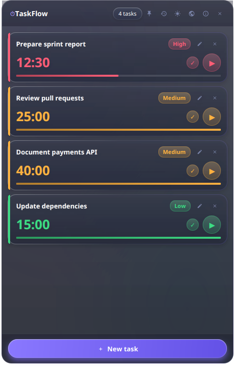
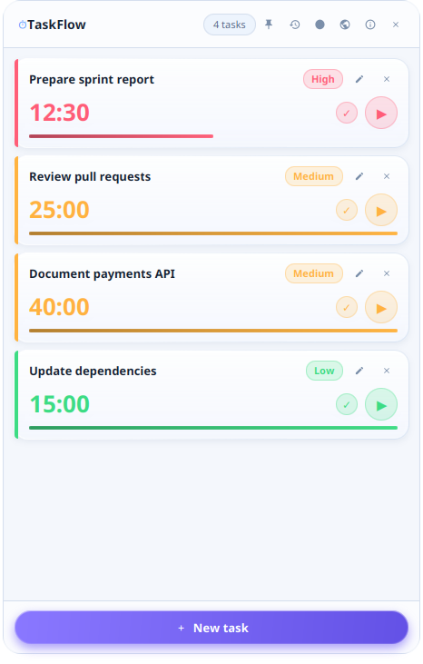

<div align="center">
  
</div>

# TaskFlow

轻量跨平台桌面任务管理器，带番茄钟计时器，基于 Java 21 与 JavaFX 构建。任务本地持久化于 SQLite，应用以原生包形式分发并捆绑 Java 运行时——终端用户无需安装 Java。

[](https://github.com/marodriguezd/TaskFlow/actions/workflows/ci.yml)
[](https://github.com/marodriguezd/TaskFlow/releases/latest)
[](LICENSE)

[English](README.md) · [Español](README_es.md) · [Deutsch](README_de.md) · [Français](README_fr.md) · [Italiano](README_it.md) · 中文

## 截图

| 深色主题 | 浅色主题 |
| --- | --- |
|  |  |

## 功能

- **任务管理**——创建、编辑、完成与删除任务
- **优先级**——为每个任务指定优先级
- **番茄钟计时器**——按任务倒计时
- **单计时器不变式**——启动一个计时器会自动暂停其他正在运行的计时器（自动暂停）
- **进度跟踪**——当前会话的可视进度条
- **历史与恢复**——已完成和已删除的任务记入历史，可恢复
- **国际化**——界面支持 6 种语言（English、Español、Deutsch、Français、Italiano、中文简体），实时切换、首次启动检测系统语言、确定性英语回退
- **SQLite 持久化**——所有任务、历史与偏好均存于本地 SQLite 数据库
- **主题切换**——浅色与深色主题，Apple Liquid Glass 风格与原生窗口半透明
- **置顶模式**——可切换的窗口置顶
- **窗口几何持久化**——会话间记住窗口位置与尺寸
- **旧数据迁移**——自动一次性导入旧版本 JSON 数据
- **音频提醒**——计时器结束时可选铃声提醒（用户可替换）

## 技术

| 领域 | 技术 |
| --- | --- |
| 语言 | Java 21 |
| UI 工具包 | JavaFX 21 |
| 构建 | Gradle（Kotlin DSL，含 wrapper） |
| 持久化 | SQLite via JDBC（`sqlite-jdbc`） |
| 测试 | JUnit 6、AssertJ、JaCoCo（最低 45% 行覆盖率） |
| 代码风格 | Spotless + Google Java Format |
| 打包 | `jpackage`，捆绑 Java 21 运行时 |
| 日志 | SLF4J + Logback |
| 旧版迁移 | Jackson（JSON） |
| 国际化 | Java `ResourceBundle`（UTF-8，6 个 locale） |

CI 流水线在 Ubuntu、Windows 与 macOS 上构建、测试、检查格式并打包。

## 架构

代码采用分层结构，表现层、应用服务、领域模型、持久化与平台集成职责清晰。包根：`io.github.marodriguezd.taskflow`。

```
io.github.marodriguezd.taskflow
├── TaskFlowApp           # JavaFX 应用入口
├── TaskFlowLauncher      # 静态 main() 启动器
├── domain/               # 纯模型类，无框架依赖
│   ├── Task, Priority
│   ├── HistoryItem, HistoryEventType
│   ├── ThemeMode, UserPreferences, WindowGeometry
├── persistence/          # SQLite 数据访问
│   ├── DatabaseManager               # 连接与 schema 管理
│   ├── TaskRepository / SqliteTaskRepository
│   ├── HistoryRepository / SqliteHistoryRepository
│   ├── PreferenceRepository / SqlitePreferenceRepository
│   ├── LegacyDataMigrator            # 旧版 JSON → SQLite 导入
│   └── PersistenceException
├── service/              # 应用/业务服务
│   ├── TaskService       # 任务用例与校验
│   ├── TimerService      # 倒计时、单活动计时器 enforcement
│   ├── PlatformService   # OS 检测、数据目录、平台默认值
│   ├── SoundService      # 计时完成音频
│   └── ValidationException
├── ui/                   # JavaFX 表现层
│   ├── MainWindow
│   ├── component/        # HeaderView, TaskCardView, ProgressBarView,
│   │                     # EmptyStateView, Icons
│   ├── dialog/           # AddTaskDialog, EditTaskDialog, HistoryDialog,
│   │                     # AboutDialog
│   ├── i18n/             # Messages, LocaleManager, Languages, PriorityLabels
│   └── theme/            # ThemeManager, UIConstants
└── util/                 # DateTimeUtil, TimeFormatter
```

- **`ui`** 不直接接触 JDBC；它调用 **`service`**，由后者编排 **`domain`** 与 **`persistence`**。
- **`domain`** 零依赖，可完全单元测试。
- **`persistence`** 是唯一接触 SQLite 的层，通过仓储接口暴露。
- **`service.PlatformService`** 隔离所有操作系统相关行为（数据目录、窗口约定、默认置顶状态）。

资源位于 `src/main/resources`：CSS 主题（`css/base.css`、`css/light.css`、`css/dark.css`）、翻译包（`i18n/messages*.properties`）、应用图标（`assets/`）、默认提醒音（`assets/bell.mp3`）与 Logback 配置。

## 上手

### 前置要求

- JDK 21（Gradle toolchain 会定位或自动 provision）

### 开发运行

```bash
./gradlew run
```

### 常用命令

```bash
./gradlew test             # 运行测试套件
./gradlew spotlessCheck    # 检查代码格式
./gradlew spotlessApply    # 应用代码格式
./gradlew build            # 编译、测试与组装
./gradlew jpackageImage    # 用 jpackage 构建独立应用镜像
./gradlew jpackagePackage  # 为当前系统构建原生包（msi/dmg/AppImage）
```

打包后的应用镜像写入 `build/dist/TaskFlow`，可直接启动：

```bash
./build/dist/TaskFlow/bin/TaskFlow
```

## 分发

`./gradlew jpackageImage` 经 [`jpackage`](https://docs.oracle.com/en/java/javase/21/docs/specs/man/jpackage.html) 生成自包含应用镜像。镜像捆绑 Java 21 运行时，因此**终端用户无需安装 Java**即可运行打包后的应用。

`./gradlew jpackagePackage` 为当前操作系统构建原生安装包：

| 系统 | 包类型 |
| --- | --- |
| Windows | `.msi` |
| macOS | `.dmg` |
| Linux | `.AppImage`（x86_64；需要兼容的 Linux userspace 与桌面/运行时库） |

TaskFlow 运行于 Windows、Linux 与 macOS。GitHub Actions 工作流（`.github/workflows/ci.yml`、`.github/workflows/release.yml`）在三个平台构建打包。

### 发布

> [!NOTE]
> **最新：[TaskFlow v1.2.3](https://github.com/marodriguezd/TaskFlow/releases/tag/v1.2.3)**——新增可调 Liquid Glass 强度滑杆，模态对话框背景 98% 不透明以保证最大可读性。原生包为 Windows（`.msi`）、Linux（`.AppImage`）与 macOS（`.dmg`，Apple Silicon）捆绑完整 Java 21 运行时，并附 SHA-256 校验和供验证下载。

推送 `v主.次.补丁` 标签（如 `v1.0.0`）时，官方发布自动发布于 [GitHub Releases 页面](https://github.com/marodriguezd/TaskFlow/releases)。流水线：

1. 校验标签格式、与 Gradle 项目版本一致且指向构建提交；
2. 在 Windows、Linux 与 macOS runner 上构建测试；
3. 用 `jpackage` 生成各平台原生安装包；
4. 校验每个产物内嵌的 `RELEASE_VERSION` 来源戳；
5. 发布稳定 GitHub Release，含 `.msi`、`.AppImage`、`.dmg` 包与 SHA-256 `checksums.txt`。

每个安装包均捆绑 Java 21 运行时，终端用户无需安装 Java。

## 数据

TaskFlow 将所有用户数据存于按用户目录，含 SQLite 数据库（`taskflow.db`）与提醒音（`bell.mp3`）。位置依平台而定：

| 平台 | 数据目录 |
| --- | --- |
| Windows | `%APPDATA%\TaskFlow` |
| macOS | `~/Library/Application Support/TaskFlow` |
| Linux | `$XDG_DATA_HOME/TaskFlow`，回退 `~/.TaskFlow` |

若已存在旧版 `~/.TaskFlow` 目录，为连续性将其保留为数据目录。

## 语言

TaskFlow 界面恰好支持六种语言：

| 语言 | 标记 |
| --- | --- |
| 英语 | `en` |
| 西班牙语 | `es` |
| 德语 | `de` |
| 法语 | `fr` |
| 意大利语 | `it` |
| 简体中文 | `zh-Hans` |

- **实时切换**——点击顶栏地球按钮选择语言；整个 UI（含任务徽标、tooltip 等打开状态）即时重绘，无需重启。
- **按用户持久化**——选择存于 `preferences` 表（`language` 键），为与 locale 无关的 BCP 47 标记。1.0.0 的旧库无需迁移：首次保存时自动添加该键。
- **首次启动检测**——首次启动从系统 locale 检测界面语言。不支持的系统语言（含葡萄牙语及其他未随附语言）回退英语；繁体中文 locale 同样回退英语，因为仅发布简体中文。
- **确定性英语回退**——翻译位于 `src/main/resources/i18n/messages*.properties`；缺失键解析到英语基础包，到处缺失的键按原样返回（记录一次）而非崩溃。测试套件强制恰好存在这六个包且完整（键与占位符 parity）。
- **不翻译**——日志输出、数据库值、优先级/历史代码与内部标识保持与 locale 无关的英语，以保证数据兼容。

## 迁移

若你用过以 JSON 存数据的旧版 TaskFlow，应用首次启动会检测旧文件并自动导入 SQLite：

- `taskflow_data.json`（任务）
- `taskflow_history.json`（历史）
- `taskflow_geometry.json`（窗口几何）
- `taskflow_settings.json`（主题与窗口偏好）

旧文件在数据目录与 home 根目录查找（`~/.taskflow_data.json`、`~/.taskflow_history.json`、`~/.taskflow_geometry.json`）。每个处理过的文件重命名加 `.migrated` 后缀（如 `taskflow_data.json.migrated`）以仅导入一次；原始内容保留为备份。迁移失败会被记录，绝不阻止应用启动。

## 开发

- **格式**由 Spotless（Google Java Format，AOSP 风格）强制。提交前运行 `./gradlew spotlessApply`；`spotlessCheck` 违规会导致 CI 失败。
- **测试**使用 JUnit 6 与 AssertJ：覆盖领域模型、服务、仓储、旧版迁移、国际化（包完整性、回退、语言检测）、计时器边界、schema 与事务行为、几何恢复与端到端流程。JaCoCo 强制最低 45% 行覆盖率。测试 headless 运行——无需显示器或 JavaFX toolkit。

## 仓库管理

推荐的 `main` 分支保护（含必需 CI 检查与签名提交考量）见 [docs/REPOSITORY_HARDENING.md](docs/REPOSITORY_HARDENING.md)。分支规则需要 GitHub 仓库管理权限，不能由源文件配置。
